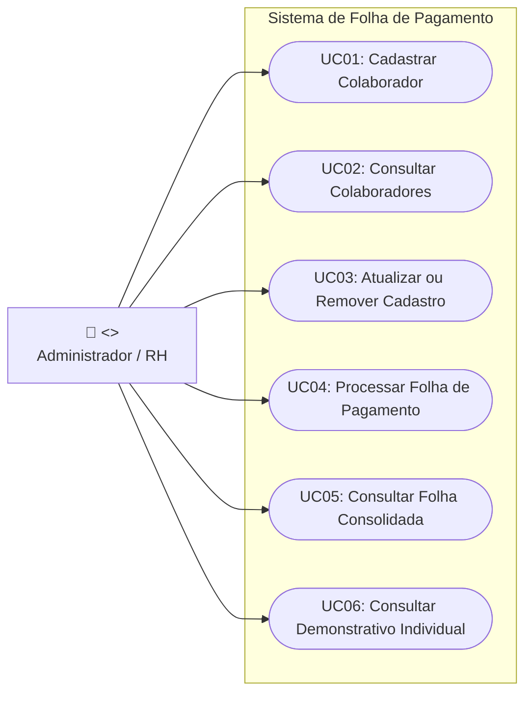
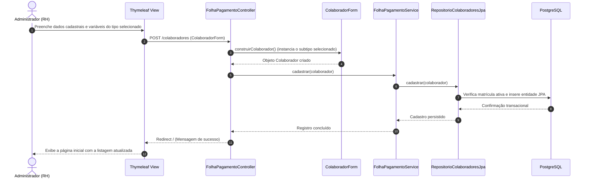
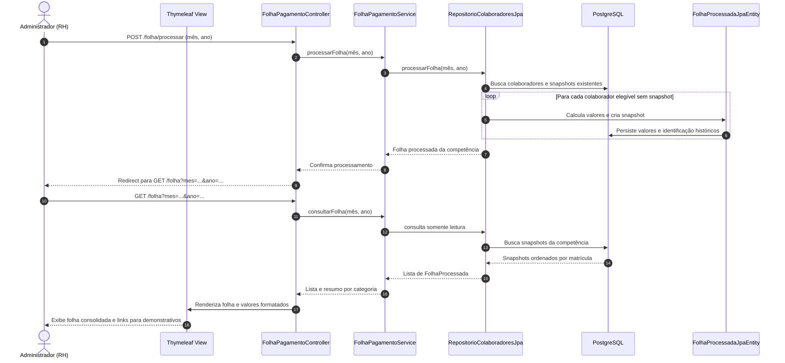
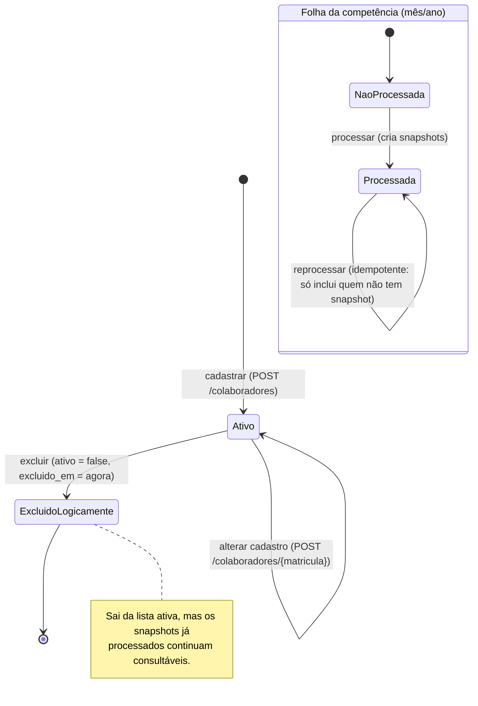
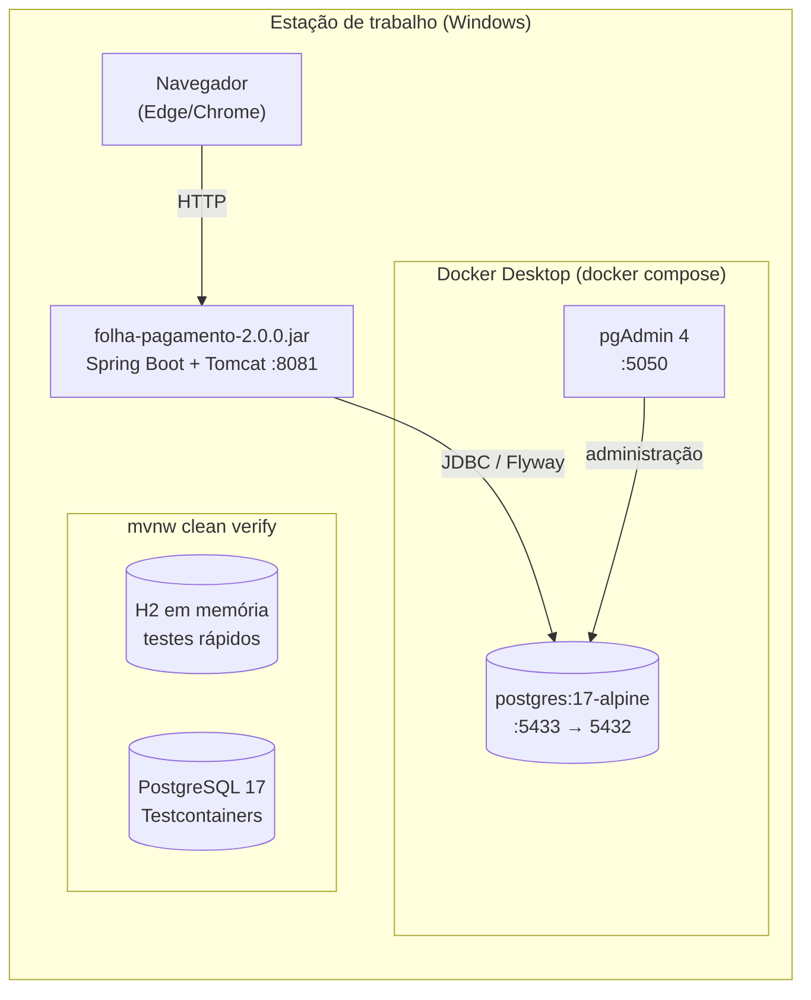
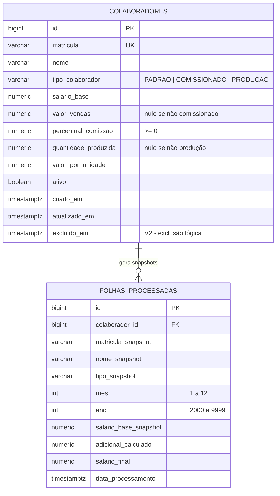

# Modelagem UML (Análise e Projeto)
**Projeto:** Folha de Pagamento  
**Versão do artefato Maven:** 2.0.0<br>
**Equipe:** Amanda Ruwer, Ana Luísa Lopes e Rafaela Acosta<br>
**Última revisão técnica:** 23/11/2026

---

# 1. Diagramas UML

### 1.1. Diagrama de Casos de Uso
O diagrama abaixo representa as interações do ator principal (**Administrador / RH**) dentro da fronteira do Sistema de Folha de Pagamento. Os rótulos foram dimensionados para garantir legibilidade integral na exportação para PDF.



---

### 1.2. Diagrama de Classes (Arquitetura Implementada)
O diagrama apresenta as principais classes e responsabilidades da implementação atual:
* **Identificação e Base Herdada:** A classe abstrata `Colaborador` utiliza `matricula` (String) como identificador de negócio e define o `salarioBase` como atributo comum herdado por todas as modalidades.
* **Regras de Cálculo por Modalidade:**
  * `ColaboradorPadrao`: recebe o `salarioBase` integral.
  * `ColaboradorComissionado`: herda `salarioBase` e adiciona o cálculo sobre `valorVendas` multiplicado pelo `percentualComissao`.
  * `ColaboradorProducao`: herda `salarioBase` e soma a bonificação baseada na `quantidadeProduzida` multiplicada pelo `valorPorUnidade`.
* **Persistência atual:** `RepositorioColaboradores` define o contrato usado pelo serviço e `RepositorioColaboradoresJpa` o implementa com Spring Data JPA e PostgreSQL.
* **Histórico da folha:** cada processamento grava snapshots imutáveis por competência em `folhas_processadas`; a exclusão de colaboradores é lógica.

```mermaid
classDiagram
    direction TB

    %% Camada de Apresentação / Web
    class FolhaPagamentoController {
        -FolhaPagamentoService service
        +inicio(Model) String
        +novo(Model) String
        +cadastrar(ColaboradorForm, BindingResult, Model, RedirectAttributes) String
        +editar(String, Model, RedirectAttributes) String
        +atualizar(String, ColaboradorForm, BindingResult, Model, RedirectAttributes) String
        +excluir(String, RedirectAttributes) String
        +folha(Integer, Integer, Model) String
        +processarFolha(Integer, Integer, RedirectAttributes) String
        +folhaIndividual(String, Integer, Integer, Model) String
    }

    class ColaboradorForm {
        -String matricula
        -String nome
        -String tipo
        -BigDecimal salarioBase
        -BigDecimal valorVendas
        -BigDecimal percentualComissao
        -BigDecimal quantidadeProduzida
        -BigDecimal valorPorUnidade
        +construirColaborador() Colaborador
    }

    %% Camada de Serviço / Aplicação
    class FolhaPagamentoService {
        -RepositorioColaboradores repositorio
        +cadastrar(Colaborador) void
        +atualizar(Colaborador) void
        +excluir(String) void
        +listar() List~Colaborador~
        +buscar(String) Optional~Colaborador~
        +processarFolha(int, int) List~FolhaProcessada~
        +consultarFolha(int, int) List~FolhaProcessada~
        +buscarFolha(String, int, int) Optional~FolhaProcessada~
        +gerarResumo(int, int) ResumoFolha
        +gerarResumo() ResumoFolha
        +resumir(List~FolhaProcessada~) ResumoFolha
    }

    class ResumoFolha {
        -int quantidadeColaboradores
        -BigDecimal totalFolha
        -Map~String, BigDecimal~ totaisPorCategoria
        -Map~String, Integer~ quantidadePorCategoria
    }

    class FormatadorMoeda {
        +formatar(double) String
        +formatar(Double) String
        +formatar(BigDecimal) String
    }

    %% Contrato e adaptador de persistência
    class RepositorioColaboradores {
        <<interface>>
        +cadastrar(Colaborador) void
        +listar() List~Colaborador~
        +buscar(String) Optional~Colaborador~
        +atualizar(Colaborador) void
        +excluir(String) void
        +processarFolha(int, int) List~FolhaProcessada~
        +consultarFolha(int, int) List~FolhaProcessada~
        +buscarFolha(String, int, int) Optional~FolhaProcessada~
    }

    class RepositorioColaboradoresJpa {
        -ColaboradorJpaRepository colaboradores
        -FolhaProcessadaJpaRepository folhas
    }

    class ColaboradorJpaRepository {
        <<interface>>
    }

    class FolhaProcessadaJpaRepository {
        <<interface>>
    }

    class ColaboradorJpaEntity {
        -Long id
        -String matricula
        -String nome
        -TipoColaborador tipoColaborador
        -BigDecimal salarioBase
        -BigDecimal valorVendas
        -BigDecimal percentualComissao
        -BigDecimal quantidadeProduzida
        -BigDecimal valorPorUnidade
        -boolean ativo
        -OffsetDateTime excluidoEm
        -OffsetDateTime criadoEm
        -OffsetDateTime atualizadoEm
    }

    class FolhaProcessadaJpaEntity {
        -Long id
        -ColaboradorJpaEntity colaborador
        -String matriculaSnapshot
        -String nomeSnapshot
        -String tipoSnapshot
        -int mes
        -int ano
        -BigDecimal salarioBaseSnapshot
        -BigDecimal adicionalCalculado
        -BigDecimal salarioFinal
        -OffsetDateTime dataProcessamento
    }

    class FolhaProcessada {
        <<record>>
        +Long id
        +String matricula
        +String nome
        +String tipo
        +int mes
        +int ano
        +BigDecimal salarioBase
        +BigDecimal adicional
        +BigDecimal salarioFinal
        +OffsetDateTime processadaEm
    }

    %% Camada de Domínio
    class Colaborador {
        <<abstract>>
        -String matricula
        -String nome
        -BigDecimal salarioBase
        +getMatricula() String
        +getNome() String
        +getSalarioBase() BigDecimal
        +getTipo() String*
        +getCodigoPersistencia() String*
        +getAdicional() BigDecimal*
        +getDetalhesRemuneracao() String*
        +getSalarioFinal() BigDecimal
    }

    class ColaboradorPadrao {
        +getTipo() String
        +getCodigoPersistencia() String
        +getAdicional() BigDecimal
        +getDetalhesRemuneracao() String
    }

    class ColaboradorComissionado {
        -BigDecimal valorVendas
        -BigDecimal percentualComissao
        +getValorVendas() BigDecimal
        +getPercentualComissao() BigDecimal
        +getCodigoPersistencia() String
        +getAdicional() BigDecimal
        +getDetalhesRemuneracao() String
    }

    class ColaboradorProducao {
        -BigDecimal quantidadeProduzida
        -BigDecimal valorPorUnidade
        +getQuantidadeProduzida() BigDecimal
        +getValorPorUnidade() BigDecimal
        +getCodigoPersistencia() String
        +getAdicional() BigDecimal
        +getDetalhesRemuneracao() String
    }

    %% Relacionamentos
    FolhaPagamentoController ..> ColaboradorForm : Recebe e valida
    FolhaPagamentoController --> FolhaPagamentoService : Orquestra fluxo
    FolhaPagamentoService --> RepositorioColaboradores : Usa contrato
    FolhaPagamentoService ..> ResumoFolha : Consolida cálculos
    RepositorioColaboradores <|.. RepositorioColaboradoresJpa : Implementa
    RepositorioColaboradoresJpa --> ColaboradorJpaRepository : CRUD JPA
    RepositorioColaboradoresJpa --> FolhaProcessadaJpaRepository : Snapshots JPA
    RepositorioColaboradoresJpa --> ColaboradorJpaEntity : Persiste
    RepositorioColaboradoresJpa --> FolhaProcessadaJpaEntity : Persiste snapshots
    FolhaProcessadaJpaEntity --> ColaboradorJpaEntity : N:1
    FolhaProcessadaJpaEntity ..> FolhaProcessada : Projeta leitura
    Colaborador <|-- ColaboradorPadrao : Herda salarioBase
    Colaborador <|-- ColaboradorComissionado : Herda salarioBase
    Colaborador <|-- ColaboradorProducao : Herda salarioBase
```

---

### 1.3. Diagramas de Sequência

**Fluxo 1: Cadastro de Colaborador (Persistência PostgreSQL e Validação por Matrícula)**


**Fluxo 2: Processamento e Consulta da Folha por Competência**



---

### 1.4. Outros diagramas relevantes

**Diagrama de estados — ciclo de vida do colaborador e da folha da competência.** A exclusão é lógica (RN009) e o snapshot de uma competência, depois de criado, não é recalculado: alterações cadastrais só afetam competências processadas depois delas.



**Diagrama de implantação — ambiente local de execução e de testes.**



**Modelo entidade-relacionamento** — detalhado em [06_Banco_Dados](../06_Banco_Dados/README.md).



---

A arquitetura em camadas, as tecnologias e a estratégia de persistência estão no [Documento de Arquitetura](../03_Projeto/Documento_Arquitetura.md).
