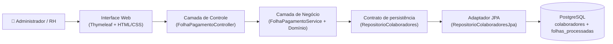

# Documento de Arquitetura
**Projeto:** Folha de Pagamento  
**Versão do artefato Maven:** 2.0.0 
**Equipe:** Amanda Ruwer, Ana Luísa Lopes e Rafaela Acosta 
**Última revisão técnica:** 23/11/2026

---

Os diagramas UML (casos de uso, classes e sequência) estão em [Modelagem UML](../02_Analise/Modelagem_UML.md).

# 1. Documento de Arquitetura

### 1.1. Visão Geral e Estilo Arquitetural
O sistema adota o padrão **MVC (Model-View-Controller)** combinado com uma arquitetura em camadas (*Layered Architecture*), garantindo baixo acoplamento, alta coesão e facilidade de manutenção evolutiva.

1. **Camada de Apresentação (Interface e Controle):** Composta pelos templates `Thymeleaf` e pelo `FolhaPagamentoController`. Recebe os formulários HTTP (`ColaboradorForm`) e encaminha comandos para a camada de serviço. Os templates usam o bean `FormatadorMoeda` para exibir valores em BRL.
2. **Camada de Negócio e Domínio:** Centralizada em `FolhaPagamentoService`, `ResumoFolha` e na hierarquia polimórfica de `Colaborador`. Isola todas as fórmulas de remuneração (Padrão, Comissionado por vendas/percentual e Produção por quantidade/valor unitário).
3. **Camada de Persistência (Infraestrutura de Dados):** `RepositorioColaboradores` define o contrato, implementado por `RepositorioColaboradoresJpa` com Spring Data JPA. Flyway versiona o esquema PostgreSQL; H2 e Testcontainers suportam os testes.

---

### 1.2. Tecnologias e Justificativas Arquiteturais

| Camada | Tecnologia | Versão / Papel | Justificativa Técnica da Escolha |
| :--- | :--- | :--- | :--- |
| **Front-end** | Thymeleaf + HTML5 / CSS3 / JS | Renderização Server-Side (SSR) | Integração nativa com o Spring MVC, permitindo bind direto de objetos Java (`ColaboradorForm` e `ResumoFolha`) no HTML sem necessidade de manter um projeto SPA separado, reduzindo a complexidade operacional. |
| **Back-end** | Java + Spring Boot | Java 17 LTS / Spring Boot 3.5.5 | Java 17 garante suporte de longo prazo (LTS), tipagem forte e segurança aritmética com `BigDecimal` para cálculos financeiros. O Spring Boot fornece injeção de dependências (`@Service`, `@Controller`) e configuração simplificada via Maven (`pom.xml`). |
| **Persistência** | PostgreSQL + Spring Data JPA | SGBD relacional / ORM | Transações, integridade referencial e restrições `CHECK`/`UNIQUE`; valores monetários persistidos em `NUMERIC(12,2)`. |
| **Migrações** | Flyway | V1 e V2 em `src/main/resources/db/migration` | Evolução versionada do esquema; Hibernate executa validação (`ddl-auto=validate`) na inicialização. |
| **Testes de persistência** | H2 + Testcontainers 1.21.4 | H2 para integração rápida; PostgreSQL 17 em container | H2 cobre os testes de integração rápidos (MockMvc + JPA). Testcontainers sobe um PostgreSQL 17 real e executa as migrations Flyway, validando a persistência no mesmo SGBD de produção. |
| **Qualidade** | JaCoCo 0.8.13 | Cobertura e *quality gate* | O build (`verify`) falha se a cobertura de linhas ou de branches ficar abaixo de 80%, conforme o PGQ. |

### 1.3. Modelo de Dados e Histórico da Folha

As migrations Flyway `V1__schema.sql` e `V2__colaboradores_data_exclusao.sql` criam e evoluem as tabelas `colaboradores` e `folhas_processadas`.

- `colaboradores` armazena os campos das três categorias em uma tabela, com `tipo_colaborador`, dados variáveis nullable, restrições de valores não negativos e matrícula única. A coluna `ativo` e o timestamp `excluido_em` implementam exclusão lógica.
- `folhas_processadas` mantém snapshots dos dados cadastrais e remuneratórios por matrícula e competência. A chave única (`colaborador_id`, `mes`, `ano`) impede snapshots duplicados da mesma folha.
- O processamento é transacional e idempotente: cria snapshots somente para colaboradores elegíveis sem registro naquela competência. Consultas e demonstrativos leem os snapshots e não recalculam folhas processadas.
- Colaboradores desligados continuam disponíveis nos snapshots já processados; sua elegibilidade para novas competências considera a data de cadastro e a data de exclusão.
- A aplicação usa PostgreSQL por padrão, `spring.jpa.hibernate.ddl-auto=validate` e Flyway para validar e versionar o esquema. `docker-compose.yml` fornece PostgreSQL e pgAdmin locais; os testes rápidos usam H2 e os testes de persistência usam PostgreSQL 17 real via Testcontainers.
- `06_Banco_Dados/seed-colaboradores.sql` é uma carga opcional e idempotente de dez colaboradores fictícios para demonstração; não é migration Flyway e não cria folhas processadas.
- O arquivo legado `dados/colaboradores.tsv` não é importado automaticamente. Qualquer migração de dados existentes deve ser planejada e validada separadamente antes de remover a fonte original.