# Estrutura Analítica do Projeto (EAP), Cronograma e Responsabilidades

**Projeto:** Sistema de Folha de Pagamento 
**Unidade Curricular:** Garantia da Qualidade de Software 
**Versão do software:** 2.0.0 
**Equipe:** Ana Luísa Lopes, Rafaela Acosta e Amanda Ruwer 

---

## 1. Estrutura Analítica do Projeto (EAP)

A EAP organiza as tarefas por foco de trabalho, mantendo os identificadores `KAN` e os prazos indicados no documento de origem.

```mermaid
flowchart TD
    Root["Sistema de Folha de Pagamento"]

    Root --> Dev1["Dev 1 — Backend, Dados e Homologação"]
    Root --> Dev2["Dev 2 — Arquitetura, Planejamento e Documentação Final"]
    Root --> Dev3["Dev 3 — Qualidade, Testes e Métricas"]

    Dev1 --> KAN01["KAN-01: Visão do sistema e ERS rastreável (06/10)"]
    Dev1 --> KAN06["KAN-06: EAP, cronograma e responsabilidades (16/10)"]
    Dev1 --> KAN07["KAN-07: README e organização inicial (16/10)"]
    Dev1 --> KAN09["KAN-09: Validar requisitos e lacunas funcionais (13/11)"]
    Dev1 --> KAN15["KAN-15: Homologação, release e apresentação (27/11)"]

    Dev2 --> KAN02["KAN-02: UML e documento de arquitetura (09/10)"]
    Dev2 --> KAN08["KAN-08: Persistência PostgreSQL com JPA e Flyway (06/11)"]
    Dev2 --> KAN12["KAN-12: Casos e aceitação no Kimi TCMS (20/11)"]
    Dev2 --> KAN14["KAN-14: Manuais de usuário e técnico (25/11)"]
    Dev2 --> KAN16["KAN-16: Anexo I acadêmico completo (30/11)"]

    Dev3 --> KAN03["KAN-03: PGQ e revisão técnica (12/10)"]
    Dev3 --> KAN04["KAN-04: Estratégia de testes e ambiente (13/10)"]
    Dev3 --> KAN05["KAN-05: Mínimo de 20 casos rastreáveis (15/10)"]
    Dev3 --> KAN10["KAN-10: Testes unitários JUnit — meta de 80% (17/11)"]
    Dev3 --> KAN11["KAN-11: Integração aplicação/PostgreSQL (19/11)"]
    Dev3 --> KAN13["KAN-13: Defeitos, métricas e revisão técnica (24/11)"]
```

---

## 2. Responsabilidades Nominais e Revisão Cruzada

| Integrante | Identificação no PDF | Foco de trabalho | Tarefas atribuídas |
| :--- | :---: | :--- | :--- |
| **Ana Luísa Lopes** | Dev 1 | Backend, dados e homologação | `KAN-01`, `KAN-06`, `KAN-07`, `KAN-09`, `KAN-15` |
| **Rafaela Acosta** | Dev 2 | Arquitetura, planejamento e documentação final | `KAN-02`, `KAN-08`, `KAN-12`, `KAN-14`, `KAN-16` |
| **Amanda Ruwer** | Dev 3 | Qualidade, testes e métricas | `KAN-03`, `KAN-04`, `KAN-05`, `KAN-10`, `KAN-11`, `KAN-13` |

O documento original define os focos como Dev 1, Dev 2 e Dev 3 para que a estrutura possa ser aplicada por diferentes equipes. Para esta equipe, o PDF identifica Ana Luísa Lopes como Dev 1, Rafaela Acosta como Dev 2 e Amanda Ruwer como Dev 3.

### 2.1. Revisão cruzada

- **Ana Luísa Lopes** revisa as entregas de **Amanda Ruwer**.
- **Amanda Ruwer** revisa as entregas de **Rafaela Acosta** e **Ana Luísa Lopes**.

---

## 3. Cronograma de Entregas

### 3.1. Marco A1 — Entrega oficial em 20/10/2026

| Período | Atividade | Tarefas / Resultado |
| :--- | :--- | :--- |
| 06/10 a 16/10 | Execução das tarefas do marco A1 | `KAN-01` a `KAN-07` |
| 17/10 a 18/10 | Integração, revisão cruzada dos artefatos e correção de apontamentos | ERS, UML, PGQ e Plano de Testes |
| 19/10 | Folga (*buffer*) para imprevistos e geração do repositório/commit final | Preparação da entrega A1 |
| **Resultado do marco** | Documentação-base validada, métricas estabelecidas e repositório organizado no board | — |

### 3.2. Marco A3 — Entrega oficial em 01/12/2026

| Período | Atividade | Tarefas / Resultado |
| :--- | :--- | :--- |
| 21/10 a 20/11 | Desenvolvimento de backend, implementação de testes unitários e de integração, e registros no TCMS | `KAN-08` a `KAN-12` |
| 21/11 a 23/11 | Janela reservada à correção de defeitos e falhas críticas | `KAN-10`, `KAN-11` e `KAN-12` |
| 24/11 a 27/11 | Coleta de métricas, elaboração dos manuais e termo de homologação/release | `KAN-13`, `KAN-14` e `KAN-15` |
| 28/11 a 29/11 | Revisão final, verificação em ambiente limpo e folga de segurança | Preparação para o fechamento |
| 30/11 | Conclusão do Anexo I Acadêmico | `KAN-16` |
| **Resultado do marco** | Documentação completa validada e sistema em execução com banco SQL | Release `QDS_2.0.0` |

---

## 4. Acompanhamento via GitHub Issues e Pull Requests

1. **Acompanhamento das tarefas:** o progresso é acompanhado pelas GitHub Issues, utilizando os filtros `is:issue state:open` e `is:issue state:closed`. Cada tarefa deve ter seu responsável atribuído no campo **Assignee**.
2. **Revisão cruzada:** as alterações são integradas por Pull Requests associados às Issues.
3. **Fechamento de tarefas concluídas:** após validação, encerrar a Issue com **Close as completed**.
4. **Tarefas descartadas ou duplicadas:** utilizar **Close as not planned** ou **Close as duplicate**, conforme o caso, para manter as métricas precisas.
5. **Ordem de revisão indicada no PDF:** Ana revisa Amanda; Amanda revisa Rafaela e Ana.
