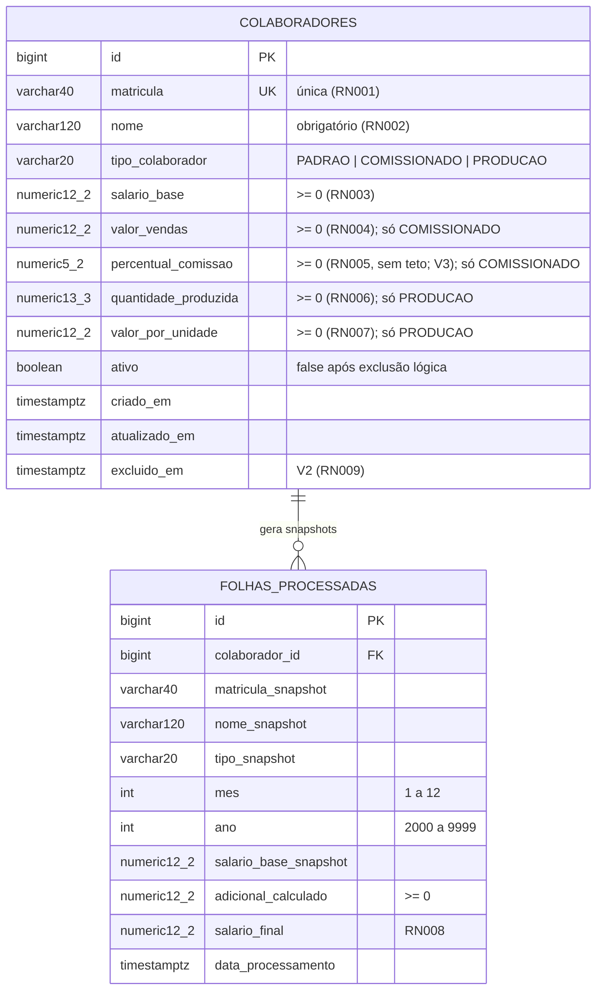

# 06 — Banco de Dados

**SGBD:** PostgreSQL 17 · **Versionamento do esquema:** Flyway · **Validação na inicialização:** `spring.jpa.hibernate.ddl-auto=validate`

## Scripts

| Script | Tipo | Descrição |
| :--- | :--- | :--- |
| [`V1__schema.sql`](../src/main/resources/db/migration/V1__schema.sql) | Migration Flyway (aplicada automaticamente) | Cria `colaboradores` e `folhas_processadas`, restrições `CHECK`/`UNIQUE`, chave estrangeira e índices |
| [`V2__colaboradores_data_exclusao.sql`](../src/main/resources/db/migration/V2__colaboradores_data_exclusao.sql) | Migration Flyway (aplicada automaticamente) | Adiciona `excluido_em` para a exclusão lógica (RN009) |
| [`seed-colaboradores.sql`](seed-colaboradores.sql) | Carga opcional de demonstração | Dez colaboradores fictícios (`FP001`–`FP010`); idempotente; não cria folhas |

As migrations ficam em `src/main/resources/db/migration/` porque é onde o Flyway as procura no *classpath*. **Nunca edite uma migration já aplicada**: crie `V3__descricao.sql`.

## Modelo de dados



### Regras garantidas pelo banco

- `UNIQUE (matricula)` em `colaboradores` (RN001).
- `CHECK` de valores não negativos (RN003–RN007) e percentual entre 0 e 100.
- `ck_colaborador_campos_por_tipo`: cada tipo só aceita os campos variáveis que lhe pertencem.
- `UNIQUE (colaborador_id, mes, ano)` em `folhas_processadas`: impede snapshot duplicado da mesma competência (processamento idempotente).
- Índices `idx_colaboradores_ativos_matricula` (parcial, só ativos) e `idx_folhas_competencia (ano, mes)`.

### Histórico (snapshots)

O processamento de uma competência grava em `folhas_processadas` uma cópia de matrícula, nome, tipo e valores calculados. Relatórios leem os snapshots, não o cadastro atual — por isso alterar ou excluir um colaborador não muda folhas já processadas (verificado em CT-037 e em PostgreSQL real por `RepositorioColaboradoresPostgresTest`).

## Criar o banco e aplicar o seed

```powershell
docker compose up -d                  # cria o banco folha_pagamento (porta 5433)
.\mvnw.cmd spring-boot:run            # Flyway aplica V1, V2 e V3 na primeira inicialização
Get-Content 06_Banco_Dados\seed-colaboradores.sql | docker compose exec -T postgres psql -U folha_app -d folha_pagamento
```

Cópia de segurança e restauração:

```powershell
docker compose exec -T postgres pg_dump -U folha_app -d folha_pagamento > backup_folha.sql
Get-Content backup_folha.sql | docker compose exec -T postgres psql -U folha_app -d folha_pagamento
```
