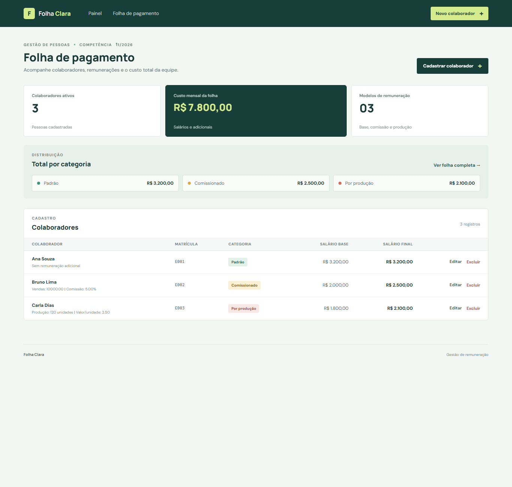
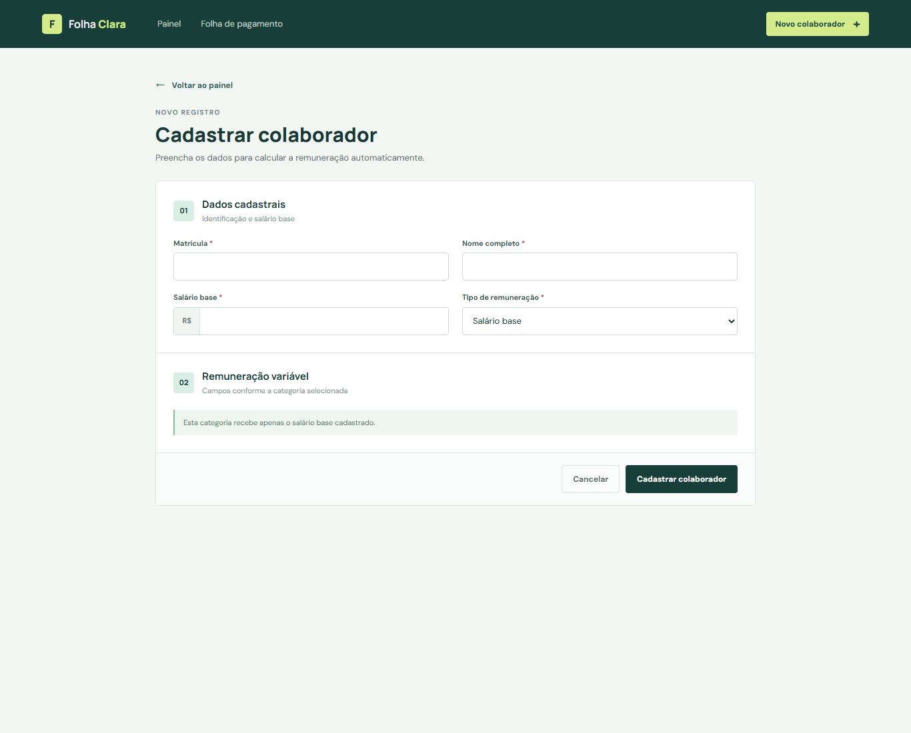
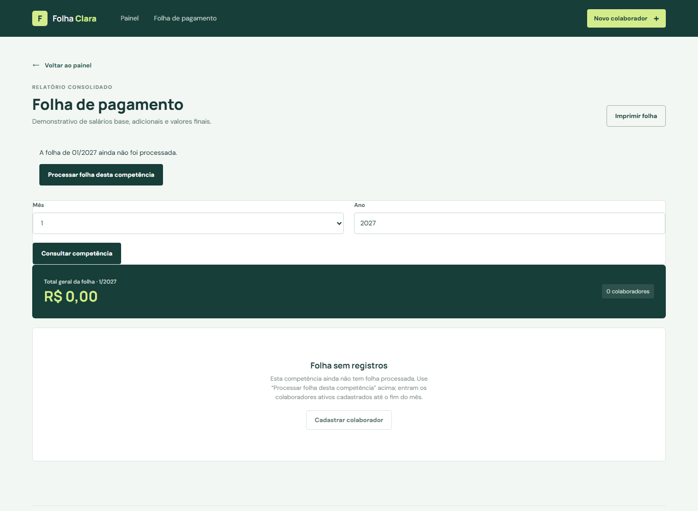
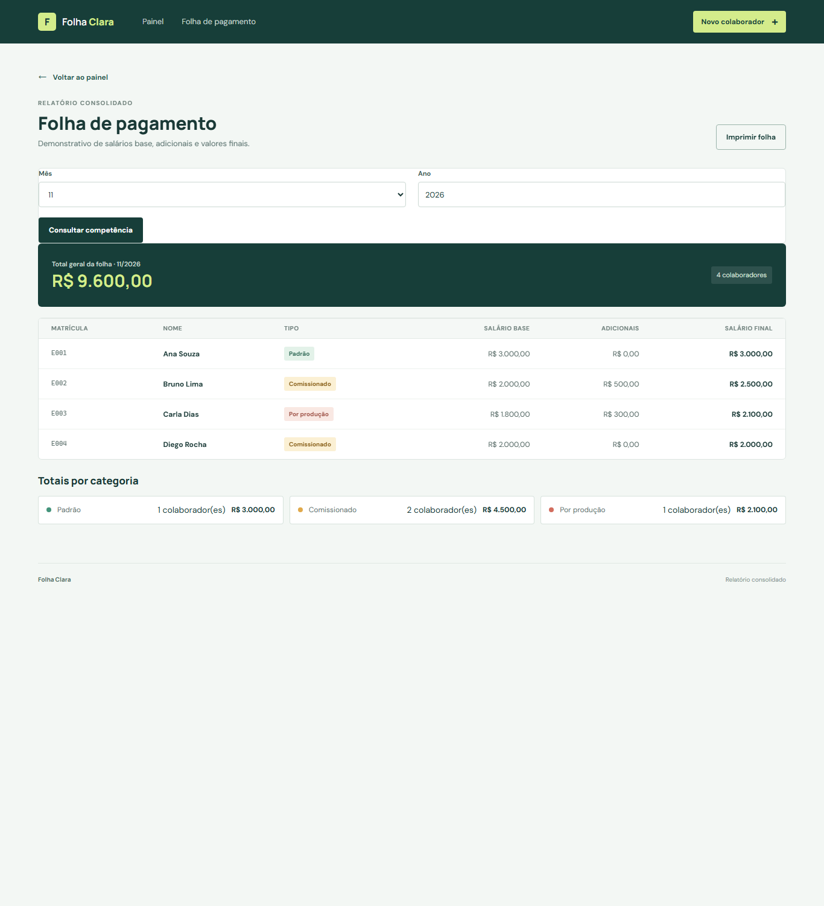
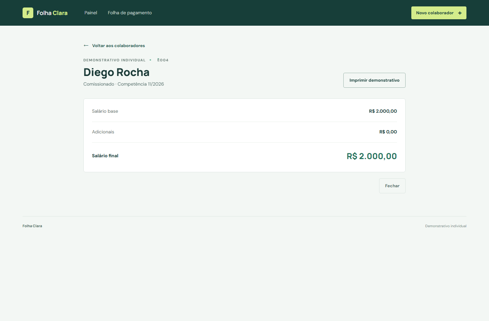

# Manual do Usuário — Folha Clara (Sistema de Folha de Pagamento)

**Versão:** 2.0.0 · **Público:** equipe de RH / administradores do sistema

---

## 1. Instalação

### 1.1. Pré-requisitos

| Software | Versão | Para quê |
| :--- | :--- | :--- |
| Windows com PowerShell | 10 ou 11 | Executar os comandos deste manual |
| JDK (Java) | 17 ou superior | Executar a aplicação |
| Docker Desktop | atual, em execução | Banco de dados PostgreSQL e pgAdmin |
| Navegador | Edge, Chrome, Firefox ou Opera | Usar o sistema |

### 1.2. Obter o sistema

```powershell
git clone https://github.com/aruwer/FolhaPagamentoA3.git
cd FolhaPagamentoA3
```

---

## 2. Configuração

1. Crie o arquivo de configuração local a partir do modelo (ele **não** deve ser compartilhado nem enviado ao Git):

   ```powershell
   Copy-Item .env.example .env
   ```

2. Abra o `.env` e, se desejar, troque as senhas. Variáveis disponíveis:

   | Variável | Padrão | Significado |
   | :--- | :--- | :--- |
   | `POSTGRES_DB` | `folha_pagamento` | Nome do banco |
   | `POSTGRES_USER` / `POSTGRES_PASSWORD` | `folha_app` / `folha_app` | Usuário e senha do banco |
   | `POSTGRES_PORT` | `5433` | Porta do banco no computador |
   | `PGADMIN_EMAIL` / `PGADMIN_PASSWORD` | `folha@app.com` / `folha_app` | Acesso ao pgAdmin |
   | `PGADMIN_PORT` | `5050` | Porta do pgAdmin |

3. Informe à aplicação a mesma senha do banco (vale para a janela atual do PowerShell):

   ```powershell
   $passwordLine = Get-Content .env | Where-Object { $_ -match '^POSTGRES_PASSWORD=' } | Select-Object -First 1
   $env:DATABASE_PASSWORD = $passwordLine.Substring("POSTGRES_PASSWORD=".Length)
   ```

4. Inicie o banco e a aplicação:

   ```powershell
   docker compose up -d
   .\mvnw.cmd spring-boot:run
   ```

5. Abra <http://localhost:8081>. Na primeira execução o sistema cria as tabelas automaticamente.

> **Opcional — dados de demonstração:** para carregar dez colaboradores fictícios, execute
> `Get-Content 06_Banco_Dados\seed-colaboradores.sql | docker compose exec -T postgres psql -U folha_app -d folha_pagamento`.

---

## 3. Operação do sistema

### 3.1. Painel

O painel lista os colaboradores **ativos** com matrícula, nome, tipo, detalhes da remuneração e salário final, além do resumo de custo mensal por categoria.



### 3.2. Cadastrar colaborador

1. Clique em **Novo colaborador** (canto superior direito).
2. Preencha **Matrícula** (letras sem acento e números), **Nome completo** e **Salário base**.
3. Escolha o **Tipo de remuneração**. Os campos da seção *Remuneração variável* mudam conforme o tipo:

   | Tipo | Campos adicionais | Cálculo do salário final |
   | :--- | :--- | :--- |
   | Salário base | — | salário base |
   | Salário + comissão | Valor das vendas, Comissão sobre vendas (%) | salário base + vendas × percentual ÷ 100 |
   | Salário + produção | Quantidade produzida, Valor por unidade | salário base + quantidade × valor por unidade |

   Campos variáveis deixados em branco são considerados **zero**.
4. Clique em **Cadastrar colaborador**.



**Mensagens de validação:** o sistema não aceita matrícula repetida, nome ou salário base em branco, valores negativos, percentual acima de 100% ou mais de duas casas decimais em valores monetários. O campo com problema fica destacado com a explicação.

### 3.3. Alterar e excluir

- **Editar:** no painel, clique em **Editar** na linha do colaborador, ajuste os dados e clique em **Salvar alterações**. A matrícula não pode ser alterada.
- **Excluir:** clique em **Excluir**. O colaborador sai da lista de ativos, mas **as folhas já processadas continuam disponíveis** (exclusão lógica). A matrícula de um colaborador excluído não pode ser reutilizada.

> Alterações de cadastro **não modificam** folhas já processadas; elas valem para as próximas competências processadas.

### 3.4. Processar a folha de uma competência

1. Clique em **Folha de pagamento** no menu.
2. Escolha o **Mês** e o **Ano** e clique em **Consultar competência**.
3. Se a competência ainda não foi processada, o sistema avisa. Clique em **Processar folha desta competência**.
4. A folha é gerada com os colaboradores elegíveis: entram os ativos cadastrados até o fim do mês e os excluídos durante o próprio mês.

O botão **Processar folha desta competência** só aparece enquanto a competência ainda **não tem folha**. Depois de processada, a folha daquela competência fica fechada na tela: colaboradores cadastrados depois não entram nela por esta interface. (O processamento é idempotente: se a mesma requisição for repetida, não duplica valores.)



---

## 4. Geração de relatórios

### 4.1. Folha consolidada (relatório do período)

Após consultar uma competência processada, a página mostra:

- **Total geral da folha** do mês/ano e a quantidade de colaboradores;
- tabela com matrícula, nome, tipo, salário base, adicionais e salário final;
- **Totais por categoria** (quantidade e valor de Padrão, Comissionado e Por produção).



### 4.2. Demonstrativo individual

Clique no nome de um colaborador na folha consolidada. O demonstrativo mostra matrícula, nome, tipo, competência, salário base, adicionais e salário final. Quando não há vendas ou produção, o adicional aparece como **R$ 0,00**.



### 4.3. Imprimir ou salvar em PDF

- Na folha consolidada, clique em **Imprimir folha**.
- No demonstrativo, clique em **Imprimir demonstrativo**.

A janela de impressão do navegador abre sem menus e botões. Escolha a impressora ou **Salvar como PDF**. Exemplo de PDF gerado: [CT-040-A3-impressao-demonstrativo-E003.pdf](../09_Homologacao/evidencias/CT-040/CT-040-A3-impressao-demonstrativo-E003.pdf).

---

## 5. Encerrar e solução de problemas

```powershell
# Ctrl + C na janela da aplicação; depois:
docker compose down          # para o banco sem apagar dados
```

Não use `docker compose down -v`: o `-v` apaga o volume com todos os dados.

| Sintoma | Causa provável | Solução |
| :--- | :--- | :--- |
| A aplicação não inicia: "password authentication failed" | `DATABASE_PASSWORD` diferente da senha do banco | Repita o passo 3 da seção 2. Se o volume foi criado com outra senha, use a senha original |
| "Port 8081 was already in use" | Outra instância já está rodando | Feche a outra instância ou use `--server.port=8082` |
| "Connection refused" na porta 5433 | Banco parado | `docker compose up -d` e confira com `docker compose ps` |
| A folha do mês aparece vazia | Competência ainda não processada | Clique em **Processar folha desta competência** |
