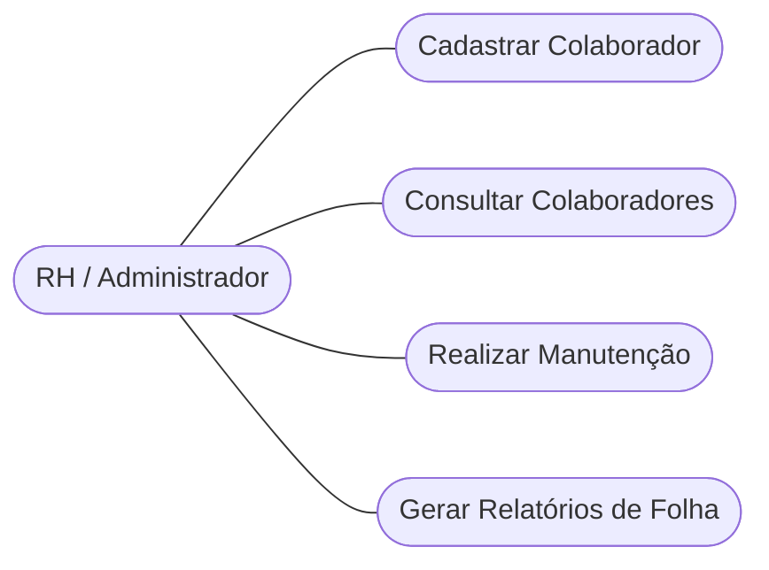
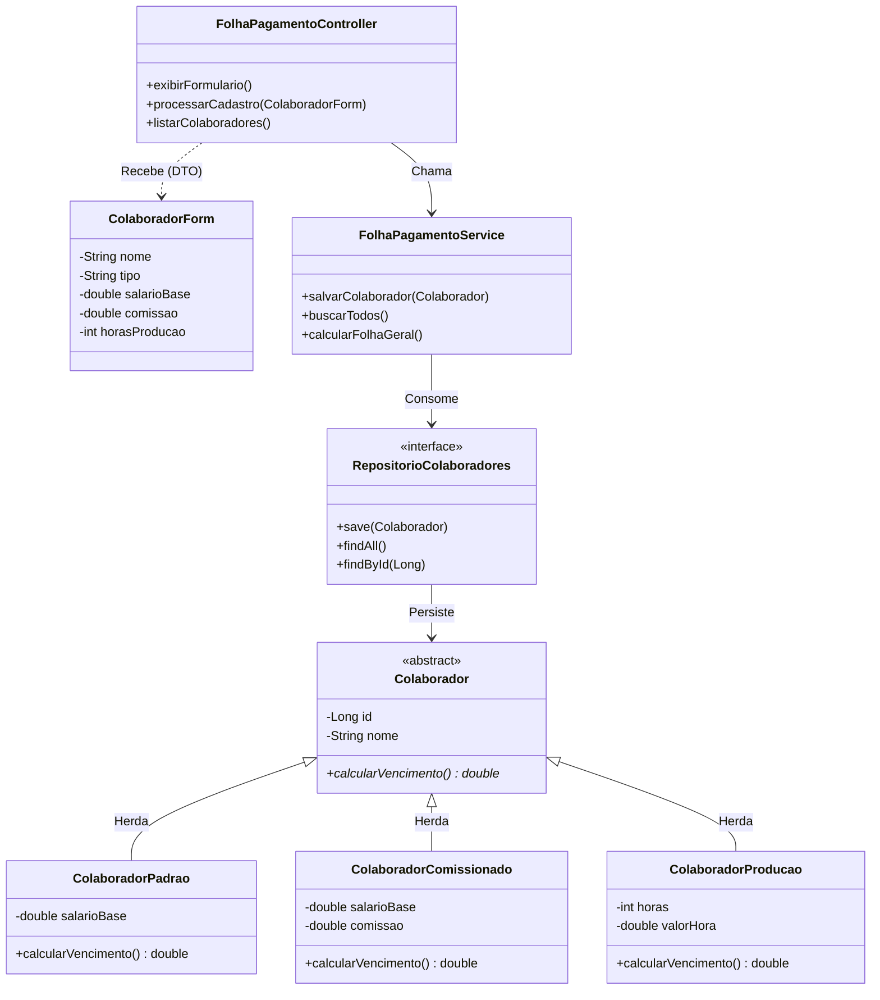
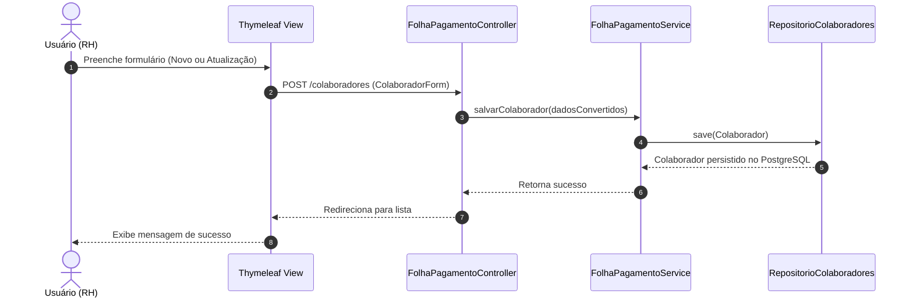
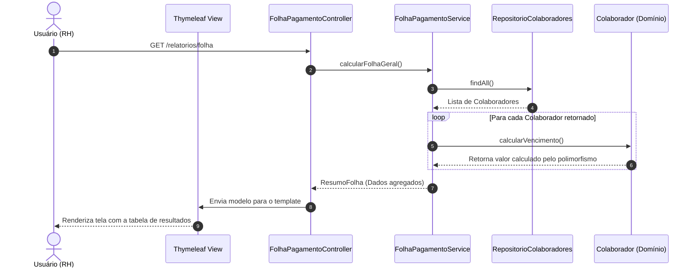
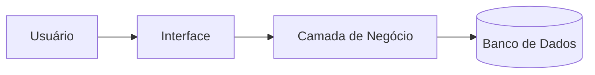

# Documento de Arquitetura e Modelagem UML
**Projeto:** Folha de Pagamento
**Versão:** QDS_1.1.0
**Responsável:** Dev 2 (Revisão: Dev 1)
**Dependências:** KAN-01
**Branch:** docs/QDS_1.1.0/uml-arquitetura

---

# 4. DIAGRAMAS UML

### Diagrama de Casos de Uso

### Diagrama de Classes

### Diagramas de Sequência

**Fluxo de Cadastro e Manutenção**

**Fluxo de Consulta e Geração de Relatórios**

---

# 5. DOCUMENTO DE ARQUITETURA

### Decisões Arquiteturais e Estrutura
A arquitetura do sistema segue o padrão **MVC (Model-View-Controller)** em camadas, promovendo uma clara separação de responsabilidades. O design suporta a inclusão de novos tipos de remuneração através de polimorfismo na classe `Colaborador`. Quando a migração de banco de dados se concretizar, as anotações do JPA tratarão do mapeamento sem impactar as camadas de Serviço ou Interface.

Abaixo apresentamos a arquitetura em camadas do sistema, partindo da interação do usuário até a persistência:

### Tecnologias
Tabela de tecnologias definidas para a implementação do projeto:

| Camada | Tecnologia |
| :--- | :--- |
| **Front-end** | Thymeleaf, HTML, CSS, JavaScript |
| **Back-end** | Java 17, Spring Boot 3.5.5 |
| **Banco** | PostgreSQL |