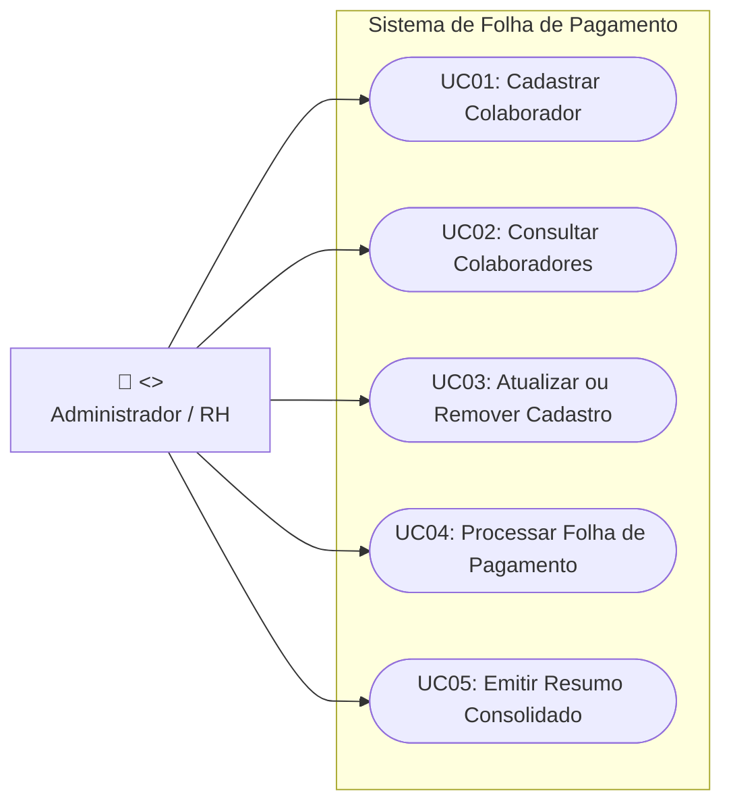
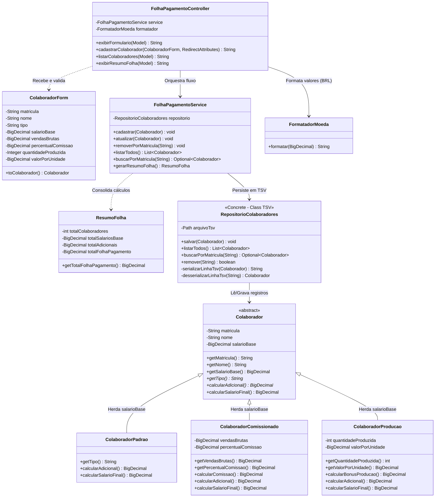
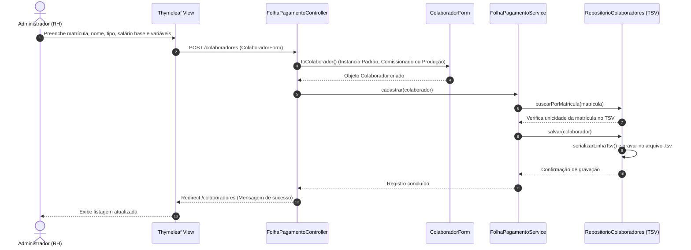
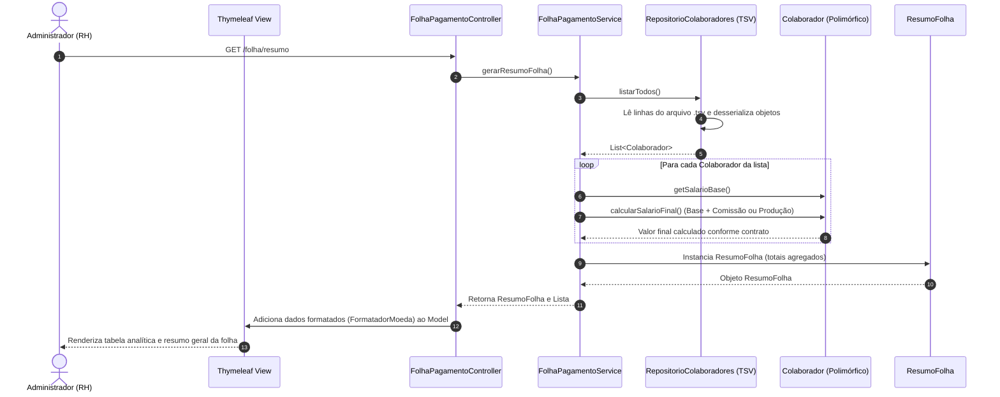
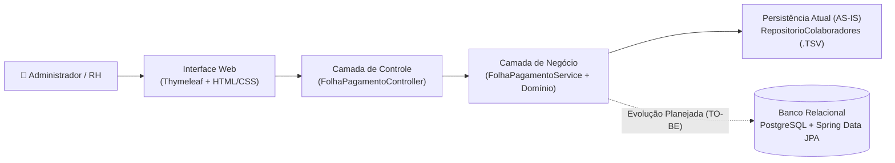

# Documento de Arquitetura e Modelagem UML
**Projeto:** Folha de Pagamento  
**Versão:** QDS_1.2.0 (Revisão Pós-Feedback A1)  
**Responsável:** Rafaela Acosta (Revisão: Amanda Ruwer)  
**Dependências:** KAN-01  
**Branch:** docs/QDS_1.1.0/uml-arquitetura  

---

# 4. DIAGRAMAS UML

### 4.1. Diagrama de Casos de Uso
O diagrama abaixo representa as interações do ator principal (**Administrador / RH**) dentro da fronteira do Sistema de Folha de Pagamento. Os rótulos foram dimensionados para garantir legibilidade integral na exportação para PDF.



---

### 4.2. Diagrama de Classes (Estado Atual AS-IS e Contrato de Domínio)
O diagrama reflete fielmente o código-fonte Java do projeto:
* **Identificação e Base Herdada:** A classe abstrata `Colaborador` utiliza `matricula` (String) como identificador de negócio e define o `salarioBase` como atributo comum herdado por todas as modalidades.
* **Regras de Cálculo por Modalidade:**
  * `ColaboradorPadrao`: recebe o `salarioBase` integral.
  * `ColaboradorComissionado`: herda `salarioBase` e adiciona o cálculo sobre `vendasBrutas` (ou total de vendas) multiplicado pelo `percentualComissao`.
  * `ColaboradorProducao`: herda `salarioBase` e soma a bonificação baseada na `quantidadeProduzida` multiplicada pelo `valorPorUnidade`.
* **Persistência Atual (TSV):** `RepositorioColaboradores` está representado como a **classe concreta atual**, que persiste os registros em arquivo tabular (`.tsv`), preparando a extração de interface para o modelo alvo em SQL.



---

### 4.3. Diagramas de Sequência

**Fluxo 1: Cadastro de Colaborador (Persistência Atual em TSV e Validação por Matrícula)**


**Fluxo 2: Consulta e Emissão do Resumo da Folha de Pagamento**


---

# 5. DOCUMENTO DE ARQUITETURA

### 5.1. Visão Geral e Estilo Arquitetural
O sistema adota o padrão **MVC (Model-View-Controller)** combinado com uma arquitetura em camadas (*Layered Architecture*), garantindo baixo acoplamento, alta coesão e facilidade de manutenção evolutiva.



1. **Camada de Apresentação (Interface e Controle):** Composta pelos templates `Thymeleaf` e pelo `FolhaPagamentoController`. Recebe os formulários HTTP (`ColaboradorForm`), aplica formatação monetária (`FormatadorMoeda`) e encaminha comandos para a camada de serviço.
2. **Camada de Negócio e Domínio:** Centralizada em `FolhaPagamentoService`, `ResumoFolha` e na hierarquia polimórfica de `Colaborador`. Isola todas as fórmulas de remuneração (Padrão, Comissionado por vendas/percentual e Produção por quantidade/valor unitário).
3. **Camada de Persistência (Infraestrutura de Dados):** Atualmente implementada pela classe concreta `RepositorioColaboradores` com armazenamento em arquivo tabular `.tsv`, estruturada para substituição transparente por um repositório relacional PostgreSQL.

---

### 5.2. Tecnologias e Justificativas Arquiteturais

| Camada | Tecnologia | Versão / Papel | Justificativa Técnica da Escolha |
| :--- | :--- | :--- | :--- |
| **Front-end** | Thymeleaf + HTML5 / CSS3 / JS | Renderização Server-Side (SSR) | Integração nativa com o Spring MVC, permitindo bind direto de objetos Java (`ColaboradorForm` e `ResumoFolha`) no HTML sem necessidade de manter um projeto SPA separado, reduzindo a complexidade operacional. |
| **Back-end** | Java + Spring Boot | Java 17 LTS / Spring Boot 3.5.5 | Java 17 garante suporte de longo prazo (LTS), tipagem forte e segurança aritmética com `BigDecimal` para cálculos financeiros. O Spring Boot fornece injeção de dependências (`@Service`, `@Controller`) e configuração simplificada via Maven (`pom.xml`). |
| **Persistência (Atual - AS-IS)** | Arquivo Tabular (`.tsv`) via Java NIO | Armazenamento local em arquivo | Permite execução imediata e portabilidade em ambiente de desenvolvimento e testes iniciais sem depender de infraestrutura externa de banco de dados. |
| **Banco de Dados (Alvo - TO-BE)** | PostgreSQL + Spring Data JPA | SGBD Relacional / ORM | O PostgreSQL assegura conformidade ACID (transações seguras), integridade referencial, restrições de domínio (`CHECK` e `UNIQUE` para matrícula) e precisão numérica (`NUMERIC(12,2)`), eliminando riscos de concorrência de leitura/escrita presentes em arquivos `.tsv`. |

---

### 5.3. Plano de Dados e Estratégia de Migração (TSV ➔ PostgreSQL)

Para atender aos requisitos de escalabilidade, segurança transacional e integridade dos dados na evolução do sistema (etapa A3), foi definido o plano de transição do repositório concreto em arquivo `.tsv` para o banco de dados relacional **PostgreSQL**.

#### 5.3.1. Modelo de Dados Alvo (Estratégia *Single Table Inheritance*)
Dada a simplicidade e o alto desempenho de leitura exigido para o cálculo global da folha, o mapeamento Objeto-Relacional (JPA) adotará a estratégia **`SINGLE_TABLE`** (`@Inheritance(strategy = InheritanceType.SINGLE_TABLE)`). Todos os colaboradores serão armazenados em uma única tabela `tb_colaborador`, diferenciados pela coluna discriminadora `tipo_contrato`, evitando `JOINs` custosos na geração de relatórios.

**Estrutura Física da Tabela Alvo (`tb_colaborador`):**
```sql
CREATE TABLE tb_colaborador (
    matricula VARCHAR(20) PRIMARY KEY,
    nome VARCHAR(120) NOT NULL,
    tipo_contrato VARCHAR(20) NOT NULL CHECK (tipo_contrato IN ('PADRAO', 'COMISSIONADO', 'PRODUCAO')),
    salario_base NUMERIC(12, 2) NOT NULL CHECK (salario_base >= 0),
    
    -- Atributos específicos de ColaboradorComissionado (NULL para demais tipos)
    vendas_brutas NUMERIC(12, 2) DEFAULT 0.00 CHECK (vendas_brutas >= 0),
    percentual_comissao NUMERIC(5, 2) DEFAULT 0.00 CHECK (percentual_comissao >= 0 AND percentual_comissao <= 100),
    
    -- Atributos específicos de ColaboradorProducao (NULL para demais tipos)
    quantidade_produzida INTEGER DEFAULT 0 CHECK (quantidade_produzida >= 0),
    valor_por_unidade NUMERIC(10, 2) DEFAULT 0.00 CHECK (valor_por_unidade >= 0),
    
    criado_em TIMESTAMP DEFAULT CURRENT_TIMESTAMP,
    atualizado_em TIMESTAMP DEFAULT CURRENT_TIMESTAMP
);
```

#### 5.3.2. Estratégia de Transição e Migração em 4 Etapas
Para garantir que a mudança de persistência não quebre os testes existentes nem afete as camadas `Controller` e `Service`:

1. **Extração de Interface (Padrão *Repository* / *Adapter*):**
   * Transformar o contrato de `RepositorioColaboradores` em uma interface de domínio (`ColaboradorRepository`).
   * Renomear a classe concreta atual para `TsvColaboradorRepositoryImpl` (ativada via `@Profile("tsv")` ou ambiente de teste legado).
2. **Implementação JPA/PostgreSQL:**
   * Adicionar as dependências `spring-boot-starter-data-jpa` e `postgresql` no `pom.xml`.
   * Mapear a hierarquia `Colaborador` com `@Entity`, `@Id` na `matricula` e `@DiscriminatorColumn(name = "tipo_contrato")`.
   * Criar a implementação `JpaColaboradorRepositoryImpl` apoiada pelo Spring Data JPA (`@Profile("postgres")`).
3. **Script ETL de Carga de Dados (Migração TSV para SQL):**
   * Executar rotina de inicialização (`CommandLineRunner`) que lê os registros existentes no arquivo `.tsv` utilizando o parser atual, valida as restrições de integridade (unicidade de `matricula` e valores não negativos) e realiza o *upsert* em lote na tabela `tb_colaborador`.
4. **Validação de Paridade:**
   * Executar a suíte de testes comparando o resultado de `gerarResumoFolha()` entre a origem `.tsv` e o destino PostgreSQL, garantindo 100% de paridade nos cálculos de salário base, comissões e produção antes de desativar a escrita em arquivo.