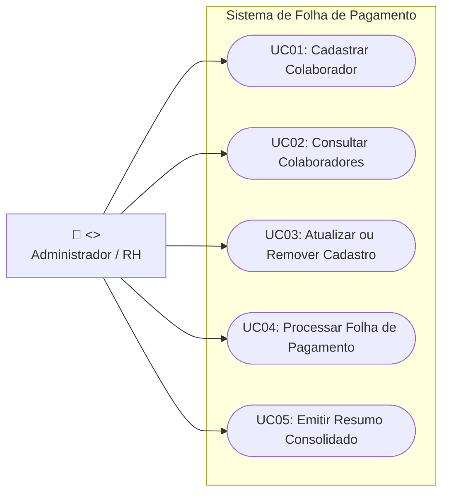
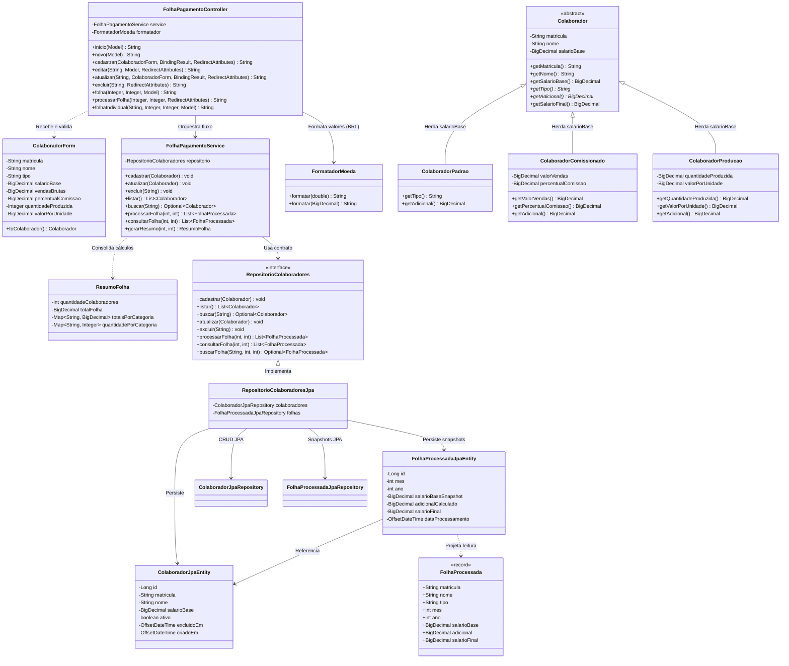
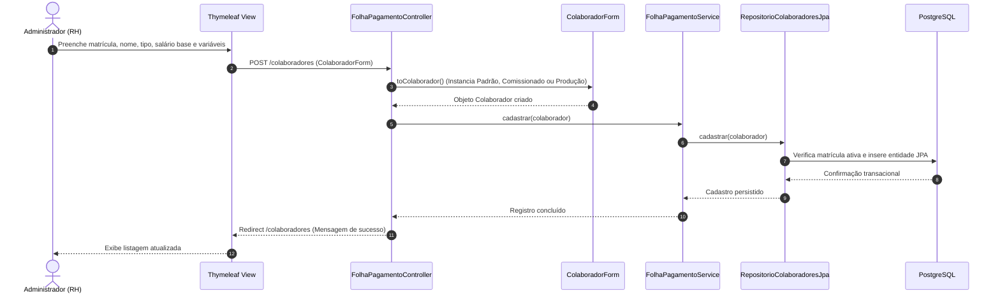
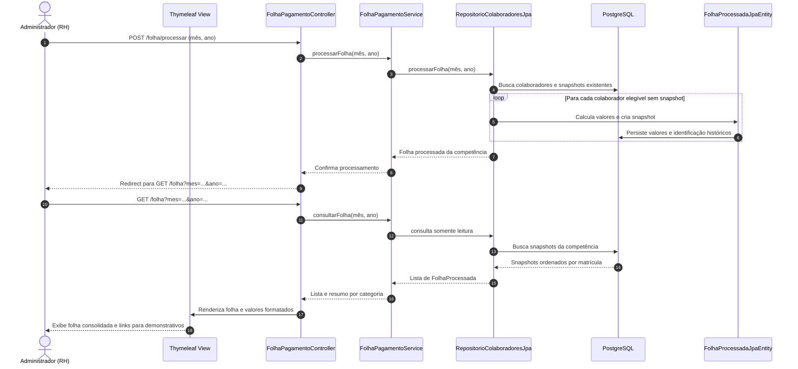
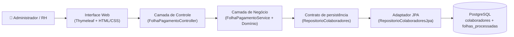

# Documento de Arquitetura e Modelagem UML
**Projeto:** Folha de Pagamento  
**Versão:** QDS_1.2.0 (Revisão Pós-Feedback A1)  
**Responsável:** Rafaela Acosta (Revisão: Amanda Ruwer)  
**Dependências:** KAN-01  
**Branch:** docs/QDS_1.1.0/uml-arquitetura  

---

# 4. DIAGRAMAS UML

### 4.1. Diagrama de Casos de Uso
O diagrama abaixo representa as interações do ator principal (**Administrador / RH**) dentro da fronteira do Sistema de Folha de Pagamento. Os rótulos foram dimensionados para garantir legibilidade integral na exportação para PDF.

---

### 4.2. Diagrama de Classes (Arquitetura Implementada)
O diagrama reflete fielmente o código-fonte Java do projeto:
* **Identificação e Base Herdada:** A classe abstrata `Colaborador` utiliza `matricula` (String) como identificador de negócio e define o `salarioBase` como atributo comum herdado por todas as modalidades.
* **Regras de Cálculo por Modalidade:**
  * `ColaboradorPadrao`: recebe o `salarioBase` integral.
  * `ColaboradorComissionado`: herda `salarioBase` e adiciona o cálculo sobre `vendasBrutas` (ou total de vendas) multiplicado pelo `percentualComissao`.
  * `ColaboradorProducao`: herda `salarioBase` e soma a bonificação baseada na `quantidadeProduzida` multiplicada pelo `valorPorUnidade`.
* **Persistência atual:** `RepositorioColaboradores` define o contrato usado pelo serviço e `RepositorioColaboradoresJpa` o implementa com Spring Data JPA e PostgreSQL.
* **Histórico da folha:** cada processamento grava snapshots imutáveis por competência em `folhas_processadas`; a exclusão de colaboradores é lógica.

---

### 4.3. Diagramas de Sequência

**Fluxo 1: Cadastro de Colaborador (Persistência PostgreSQL e Validação por Matrícula)**

**Fluxo 2: Processamento e Consulta da Folha por Competência**

---

# 5. DOCUMENTO DE ARQUITETURA

### 5.1. Visão Geral e Estilo Arquitetural
O sistema adota o padrão **MVC (Model-View-Controller)** combinado com uma arquitetura em camadas (*Layered Architecture*), garantindo baixo acoplamento, alta coesão e facilidade de manutenção evolutiva.

1. **Camada de Apresentação (Interface e Controle):** Composta pelos templates `Thymeleaf` e pelo `FolhaPagamentoController`. Recebe os formulários HTTP (`ColaboradorForm`), aplica formatação monetária (`FormatadorMoeda`) e encaminha comandos para a camada de serviço.
2. **Camada de Negócio e Domínio:** Centralizada em `FolhaPagamentoService`, `ResumoFolha` e na hierarquia polimórfica de `Colaborador`. Isola todas as fórmulas de remuneração (Padrão, Comissionado por vendas/percentual e Produção por quantidade/valor unitário).
3. **Camada de Persistência (Infraestrutura de Dados):** `RepositorioColaboradores` define o contrato, implementado por `RepositorioColaboradoresJpa` com Spring Data JPA. Flyway versiona o esquema PostgreSQL; H2 e Testcontainers suportam os testes.

---

### 5.2. Tecnologias e Justificativas Arquiteturais

| Camada | Tecnologia | Versão / Papel | Justificativa Técnica da Escolha |
| :--- | :--- | :--- | :--- |
| **Front-end** | Thymeleaf + HTML5 / CSS3 / JS | Renderização Server-Side (SSR) | Integração nativa com o Spring MVC, permitindo bind direto de objetos Java (`ColaboradorForm` e `ResumoFolha`) no HTML sem necessidade de manter um projeto SPA separado, reduzindo a complexidade operacional. |
| **Back-end** | Java + Spring Boot | Java 17 LTS / Spring Boot 3.5.5 | Java 17 garante suporte de longo prazo (LTS), tipagem forte e segurança aritmética com `BigDecimal` para cálculos financeiros. O Spring Boot fornece injeção de dependências (`@Service`, `@Controller`) e configuração simplificada via Maven (`pom.xml`). |
| **Persistência** | PostgreSQL + Spring Data JPA | SGBD relacional / ORM | Transações, integridade referencial e restrições `CHECK`/`UNIQUE`; valores monetários persistidos em `NUMERIC(12,2)`. |
| **Migrações** | Flyway | V1 e V2 em `src/main/resources/db/migration` | Evolução versionada do esquema; Hibernate executa validação (`ddl-auto=validate`) na inicialização. |
| **Testes de persistência** | H2 + Testcontainers | H2 para integração rápida; PostgreSQL 17 em container | Testa o adaptador e a compatibilidade das migrations com o SGBD alvo quando Docker está disponível. |

### 5.3. Modelo de Dados e Histórico da Folha

As migrations Flyway `V1__schema.sql` e `V2__colaboradores_data_exclusao.sql` criam e evoluem as tabelas `colaboradores` e `folhas_processadas`.

- `colaboradores` armazena os campos das três categorias em uma tabela, com `tipo_colaborador`, dados variáveis nullable, restrições de valores não negativos e matrícula única. A coluna `ativo` e o timestamp `excluido_em` implementam exclusão lógica.
- `folhas_processadas` mantém snapshots dos dados cadastrais e remuneratórios por matrícula e competência. A chave única (`colaborador_id`, `mes`, `ano`) impede snapshots duplicados da mesma folha.
- O processamento é transacional e idempotente: cria snapshots somente para colaboradores elegíveis sem registro naquela competência. Consultas e demonstrativos leem os snapshots e não recalculam folhas processadas.
- Colaboradores desligados continuam disponíveis nos snapshots já processados; sua elegibilidade para novas competências considera a data de cadastro e a data de exclusão.
- A aplicação usa PostgreSQL por padrão, `spring.jpa.hibernate.ddl-auto=validate` e Flyway para validar e versionar o esquema. `docker-compose.yml` fornece PostgreSQL e pgAdmin locais; os testes rápidos usam H2 e a suíte Testcontainers usa PostgreSQL 17 quando Docker está disponível.
- O arquivo legado `dados/colaboradores.tsv` não é importado automaticamente. Qualquer migração de dados existentes deve ser planejada e validada separadamente antes de remover a fonte original.